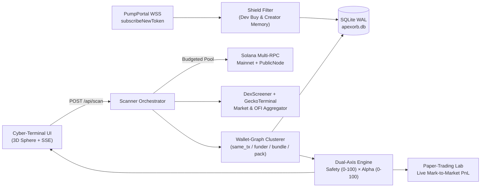

# Полный технический аудит и архитектура ApexOrb

Этот документ подробно разбирает внутреннюю механику **ApexOrb**, сравнение с открытой частью **QuantumOrb (`QuantumOrb/QuantOrb`)** и математику квантовых модулей, добавленных поверх базового ончейн-сканера.

---

## 1. Архитектурный пайплайн

---

## 2. Что было закрыто в QuantumOrb и реализовано с нуля в ApexOrb

В публичном репозитории `QuantumOrb/QuantOrb` открыты только ~10% кода (чистые правила скоринга `rules/`, декодеры `chain/` и `market/pools.js`). В **ApexOrb** реализована и открыта **вся серверная логика**:

1. **Multi-RPC пул с бюджетом ([`src/solana/rpc.js`](../src/solana/rpc.js)):**
   - Ротация нескольких Solana JSON-RPC эндпоинтов с автоматическим cooldown на HTTP `429` / `5xx` и экспоненциальной задержкой.
   - Жёсткий бюджет `MAX_RPC_CALLS` на один скан и TTL-кеширование повторяющихся запросов (`getTransaction`, `getAccountInfo`).
2. **Обход реального Float ([`src/engine/scanner.js`](../src/engine/scanner.js)):**
   - Декодирование `Mint` (SPL / Token-2022), `BondingCurve` PDA (`["bonding-curve", mint]`), `Metaplex` PDA.
   - Разрешение владельцев `getTokenLargestAccounts` и отсев инфраструктурных аккаунтов (`INFRA_PROGRAMS`: `pump.fun`, `PumpSwap`, `Raydium V4/CPMM/CLMM/LaunchLab`, `Meteora`, `Orca`, `Streamflow`, `Jupiter Lock`, `Burn`, `Mayhem Vault`).
3. **Восстановление графа связей ([`src/engine/cluster.js`](../src/engine/cluster.js)):**
   - **`same_tx` (`proven`):** кошельки получили токен в одной и той же сигнатуре транзакции.
   - **`same_funder` (`proven`):** кошельки получили стартовый SOL от одного и того же обычного кошелька (`fundingRoot`). Известные горячие кошельки бирж (Binance, Coinbase, OKX, Bybit, Kraken и др.) и Jito Tip аккаунты исключены через `NON_OPERATOR_FUNDERS`, чтобы не склеивать независимых пользователей.
   - **`direct_transfer` (`proven`):** прямой перевод токенов между топ-холдерами без свопа.
   - **`slot_bundle` (`proven`):** совместный вход в `slot-0` создания токена или в одном слоте с Jito-чаевыми.
   - **`pack` (поведенческий, вес `0.6`):** $\ge 3$ свежих кошелька ($\le 4$ транзакций в истории), вошедших в окне $\le 5$ слотов с размером позиции в пределах $\pm 30\%$.
   - **Union-Find (DSU):** транзитивное объединение доказанных связей (`A—B` и `B—C` $\Rightarrow$ единый оператор `OP-1`).
4. **Кросс-токенная память (`Operator Memory`, [`src/db.js`](../src/db.js)):**
   - Каждый скан обновляет таблицы `creator_memory` и `operator_memory`.
   - Если `fundingRoot` ранее фигурировал в токене со статусом `DANGER`, при следующем скане срабатывает жёсткий флаг рецидивиста (`Recidivist Root`), обрушивающий `Safety` в зону `DANGER`.

---

## 3. Математика Dual-Axis Scoring (`src/engine/scoring.js`)

### Ось 1: `SAFETY (0–100)` — защита от рагпула

Пять линейно масштабируемых компонентов между порогом полного балла $g_k$ и нуля $b_k$:
$$s_k = \frac{\mathrm{round}\left(10 \cdot w_k \cdot \mathrm{clamp}\left(\frac{b_k - x_k}{b_k - g_k}, 0, 1\right)\right)}{10}$$

| Компонент | Вес $w_k$ | Полный балл $g_k$ | Ноль $b_k$ | Что измеряет |
|---|---:|---:|---:|---|
| `Biggest Operator` | 35 | $\le 10\%$ падения | $\ge 60\%$ падения | Просад цены при сливе крупнейшего кластера: $1 - (R / (R + q))^2$ |
| `Fresh Wallets` | 25 | $\le 10\%$ | $\ge 80\%$ | Доля прочитанных топ-холдеров без прошлой истории |
| `Received (Transfer)` | 20 | $\le 1\%$ | $\ge 10\%$ | Доля float, полученная трансферами, а не покупкой |
| `Unsold Snipers` | 10 | $\le 1\%$ | $\ge 15\%$ | Доля непроданных снайперов первых ~30 сек |
| `Top-20 Share` | 10 | $\le 25\%$ | $\ge 70\%$ | Суммарная концентрация топ-20 держателей |

- **Красные флаги (`DANGER`, потолок 38):** оператор $\ge 2$ кошельков роняет цену на $\ge 50\%$; $\ge 80\%$ свежих кошельков; $\ge 10\%$ получено трансферами; совпадение в `Operator Memory`.
- **Ограничители (`RISKY`, потолок 59):** кластер/стая от 3+ кошельков; одиночный кит с impact $\ge 50\%$; ликвидность $< \$1,000$; $\ge 3$ непрочитанных крупных кошелька (`PARTIAL`).

### Ось 2: `ALPHA & MICROSTRUCTURE (0–100)` — квантовая изюминка

| Компонент | Вес | Логика |
|---|---:|---|
| `Orderflow Imbalance (OFI)` | 30 | Баланс покупок/продаж $\frac{\text{Buys} - \text{Sells}}{\text{Buys} + \text{Sells}}$ за `5m` / `1h` |
| `Velocity & Curve` | 25 | Прогресс Bonding Curve (sweet spot `15%–92%` до миграции) + ценовой импульс |
| `Wash-Trading Gate` | 20 | Отношение `Turnover_24h / Liquidity`: свыше `12x` снижает балл, свыше `40x` обнуляет |
| `Exitability Gate` | 15 | Проскальзывание выхода для позиции `$1,000`: $\left(1 - \left(\frac{L/2}{L/2 + 1000}\right)^2\right) + 1.2\%$ fee; при издержках $> 12\%$ ставит потолок `55` |
| `Organic Breadth` | 10 | Отношение независимых операторов к общему числу топ-холдеров |

### Матрица решений (`Safety × Alpha`)
- **`SNIPER_GEM`** (`Safety >= 65 && Alpha >= 62`) $\rightarrow$ `PAPER_ENTER`
- **`SAFE_SLOW`** (`Safety >= 65 && Alpha < 62`) $\rightarrow$ `WATCH`
- **`HIGH_RISK_TRAP`** (`Safety < 65 && Alpha >= 62`) $\rightarrow$ `AVOID_TRAP`
- **`TOXIC_AVOID`** (`Safety < 65 && Alpha < 62`) $\rightarrow$ `SKIP`
